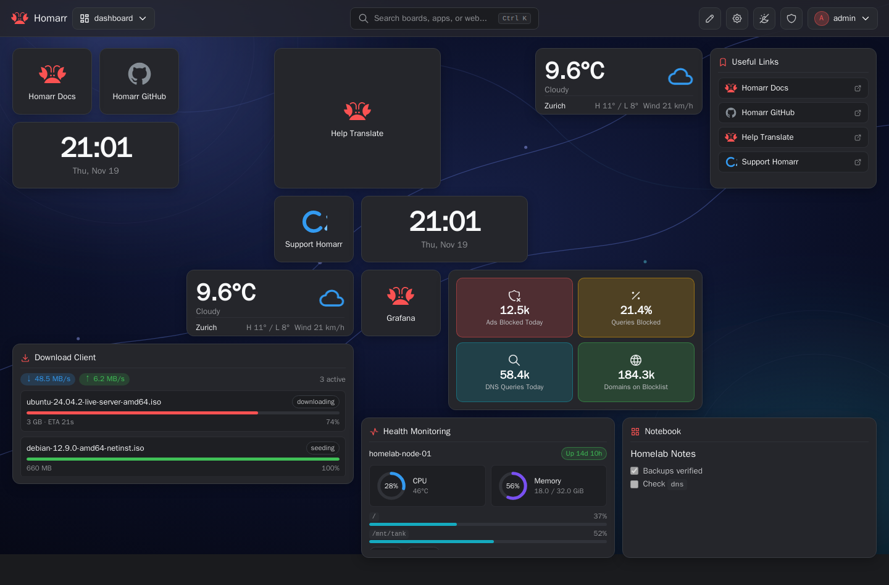

<p align="center">
  
</p>

<p align="center">
  <strong>Sleek, modern self-hosted homelab dashboard — rewritten as a 15-crate static Rust workspace.</strong>
</p>

<!-- Badges -->
<p align="center">
  <a href="https://github.com/Arata12/homarr/actions/workflows/ci.yml">
    
  </a>
  <a href="https://github.com/Arata12/homarr/releases/latest">
    
  </a>
  
  <a href="https://github.com/Arata12/homarr/pkgs/container/homarr">
    
  </a>
  <a href="LICENSE">
    
  </a>
  <a href="https://github.com/homarr-labs/homarr">
    
  </a>
</p>

<!-- Quick Links -->
<p align="center">
  <a href="#-features"><strong>Features ✨</strong></a> •
  <a href="#-rust-v30-vs-original-homarr-nodejs"><strong>Rust vs Node.js ⚡</strong></a> •
  <a href="#-installation"><strong>Install 💻</strong></a> •
  <a href="#-integrations"><strong>92 Integrations 🔌</strong></a> •
  <a href="#-workspace-architecture--development"><strong>Architecture 🦀</strong></a> •
  <a href="#configuration--cli"><strong>API &amp; CLI 🛠️</strong></a>
</p>

<p align="center">
  
</p>

<br/>

<a id="-features"></a>


- 🦀 **Ultra-Lightweight Static Rust Runtime** — Compiles into standalone `musl` binaries packaged in a shell-free Debian distroless image (**82.8 MB** on disk, **~5.3 MiB** idle RAM, **~11.4 MiB** after full E2E load)
- 🖌️ **Interactive Drag-and-Drop Grid Editor** — Multi-layout responsive grid with resizable tiles, collapsible category sections, live widget configuration modals, custom borders/CSS classes, and zero YAML
- ✨ **92 Integrations &amp; 67 Built-in Widgets** — Native async clients for media servers, `*arr` automation, download clients, DNS sinkholes, hypervisors/UPS/health telemetry, firewalls/VPNs, Traefik/network tools, smart home, stocks, weather, calendars, RSS, and Markdown notebooks
- 📌 **Fast App Directory &amp; Live Status Pings** — Bundled icon search across local &amp; curated icons plus live HTTP/status dot checks without external browser bloat
- 👤 **Users, Groups, RBAC &amp; Invites** — Granular permissions per board and integration, first-run Onboarding Studio (`/init`), invite links, one-time revealed API keys (`ApiKey` header), and optional trusted-proxy SSO (`AUTH_TRUSTED_PROXY_HEADER`)
- 🛡️ **Hardened Security by Default** — Bcrypt password hashing, Node.js-compatible AES-256-CBC/HMAC secret vault, auto-generated persistent secrets in `STATIC_DATA_DIR/secrets` (never logged), HTTPS-aware `Secure` cookies, strict `Origin` CSRF validation, and SSRF-guarded outbound HTTP requests
- 🗄️ **SQLite &amp; PostgreSQL (`sqlx`) with Versioned Migrations** — 41-table migrations that seamlessly adopt existing SQLite/PostgreSQL schemas, plus portable JSON workspace Backup &amp; Restore
- 🕔 **Real-Time WebSockets &amp; Resilient Redis Fallback** — Tokio background cron scheduler (`/manage/tools/tasks`) and `/websockets` streaming; falls back cleanly to in-memory pub/sub in ~12 s if Redis is unavailable
- 🔍 **Spotlight (`Ctrl+K`) &amp; 36 Languages** — Fuzzy search across boards, apps, integrations, web search bangs (`!prefix`), quick actions, and admin pages with 36 localization catalogs
- 🤖 **OpenAPI 3.1, MCP &amp; Custom Widgets v2** — Interactive `/reference/api` explorer, Model Context Protocol server (`POST /api/mcp`), AI Assistant config, and standalone `homarr-workshop` service
- 🐳 **Docker, Kubernetes &amp; Native Healthcheck** — Container management via `bollard`, optional Kubernetes resource inspection, and built-in `homarr healthcheck` CLI probe for distroless containers

<br/>

## ⚡ Rust v3.0 vs Original Homarr (Node.js)

Measured side-by-side on `x86_64` Docker (`homarr-release-test:amd64` vs `ghcr.io/homarr-labs/homarr:latest`) using Chromium Playwright across 34 rendered views and interactive CRUD flows:

| Metric | Homarr v3.0 (Pure Rust) | Homarr v2 (Node.js + Next.js) |
| --- | --- | --- |
| **Docker Image Size** | **82.8 MB** (distroless static `musl`) | **872 MB** (`node` + Next.js bundle) |
| **Idle Container RAM** | **~5.3 MiB** | **~262 – 370 MiB** |
| **Post-E2E Active RAM / CPU** | **11.44 MiB** / **0.01%** | **370.3 MiB** / **0.20%** |
| **HTTP &amp; UI Stack** | Axum + Tokio + SSR HTML | Next.js + tRPC + React/Mantine |
| **Container Healthcheck** | Built-in `homarr healthcheck` binary | HTTP probe via shell/wget |
| **Databases &amp; Cache** | SQLite / PostgreSQL (`sqlx`) + Redis or memory fallback | SQLite / PostgreSQL + Redis |

<br/>

<a id="-installation"></a>


### 1. Docker Run (Distroless Multi-Arch `amd64` / `arm64`)

Release images are built natively on `amd64` and `arm64` from static `musl` binaries and published to GHCR:

```bash
docker run -d \
  --name homarr \
  --restart unless-stopped \
  -p 7575:7575 \
  -v homarr_appdata:/appdata \
  -v /var/run/docker.sock:/var/run/docker.sock:ro \
  ghcr.io/arata12/homarr:latest
```

Then open **`http://localhost:7575`** — first boot redirects to `/init` to create the administrator account, choose your color scheme, and optionally seed a starter dashboard.

> [!NOTE]
> If `SECRET_ENCRYPTION_KEY` or `AUTH_SECRET` are omitted, Homarr generates cryptographically random secrets on first start and persists them atomically (`0600`) under `/appdata/secrets/` (`STATIC_DATA_DIR/secrets`) so sessions and encrypted integration credentials survive restarts without exposing keys in logs.

### 2. Docker Compose

**Minimal standalone deployment (SQLite + in-memory cache):**

```yaml
services:
  homarr:
    image: ghcr.io/arata12/homarr:latest
    container_name: homarr
    restart: unless-stopped
    ports:
      - "7575:7575"
    volumes:
      - homarr_appdata:/appdata
      - /var/run/docker.sock:/var/run/docker.sock:ro
    environment:
      # Optional: pin explicit secrets instead of auto-persisting under /appdata/secrets
      SECRET_ENCRYPTION_KEY: "<64-hex-chars>"
      AUTH_SECRET: "<random-secret-string>"

volumes:
  homarr_appdata:
```

**Full stack from this repository** (includes external Redis, optional PostgreSQL 17, Custom Widget Workshop, CLI, and Rust dev toolchain in [docker-compose.yml](docker-compose.yml)):

```bash
# Build and run Homarr + Redis
docker compose up -d redis homarr

# Enable PostgreSQL 17 and/or Custom Widget Workshop
docker compose --profile postgres --profile workshop up -d

# Run administration CLI
docker compose --profile cli run --rm cli users list
```

### 3. Static Linux Binaries (`linux-amd64` / `linux-arm64`)

Each GitHub Release attaches static tarballs (`homarr-<version>-linux-amd64.tar.gz` and `homarr-<version>-linux-arm64.tar.gz`) with SHA-256 checksums containing `homarr-server`, `homarr`, `homarr-workshop`, and `assets/`:

```bash
tar -xzf homarr-<version>-linux-amd64.tar.gz
cd homarr-<version>-linux-amd64
STATIC_DATA_DIR=./appdata DB_URL=./appdata/db/db.sqlite ASSETS_DIR=./assets ./homarr-server
```

### Configuration &amp; CLI

<details>
<summary><strong>Environment variables &amp; CLI subcommands</strong></summary>

| Variable | Default | Description |
| --- | --- | --- |
| `HOST` / `PORT` | `0.0.0.0` / `7575` | HTTP/WebSocket bind host and port |
| `STATIC_DATA_DIR` | `static-data` (`/appdata` in Docker) | Persistent data directory (also stores auto-generated `secrets/`) |
| `DB_DRIVER` | `sqlite` | `sqlite` or `postgres` |
| `DB_URL` | `/appdata/db/db.sqlite` | Database connection URL (or `DB_HOST`, `DB_PORT`, `DB_USER`, `DB_PASSWORD`, `DB_NAME`) |
| `ASSETS_DIR` | `assets` (`/app/assets` in Docker) | Path to static CSS/JS, icons, and 36 locale JSON files |
| `SECRET_ENCRYPTION_KEY` | Auto-persisted (64 hex chars) | AES-256 encryption key for integration secrets |
| `AUTH_SECRET` | Auto-persisted | Session &amp; CSRF signing secret |
| `AUTH_COOKIE_SECURE` | Auto (`true` on HTTPS) | Explicit override for session cookie `Secure` flag |
| `AUTH_TRUSTED_PROXY_HEADER` | Unset | Reverse-proxy header name for pre-authenticated SSO username |
| `REDIS_IS_EXTERNAL` / `REDIS_DISABLED` | `false` / `false` | Use external Redis (`REDIS_HOST`, `REDIS_PORT`, `REDIS_PASSWORD`) with ~12 s memory fallback |
| `DOCKER_SOCKET_PATHS` | `/var/run/docker.sock` | Comma-separated Docker socket paths (or `DOCKER_HOSTNAMES` / `DOCKER_PORTS`) |
| `ENABLE_KUBERNETES` | `false` | Enable in-cluster Kubernetes inspection tools |
| `LOG_LEVEL` | `info` | Server log filter level (`trace`, `debug`, `info`, `warn`, `error`) |

**Admin CLI (`homarr`):**

```text
homarr healthcheck [--url URL]              # Exit 0 when /api/health/live returns HTTP 200
homarr users list                           # List users
homarr users delete <ID>                    # Delete user by ID
homarr users reset-password <ID> <PASS>     # Reset password
homarr users fix-usernames                  # Normalize legacy usernames
homarr users recreate-admin <USER> <PASS>   # Recreate/promote admin account
homarr integrations list                    # List configured integrations
homarr db migrate | seed                    # Apply SQLx migrations or seed defaults
```

</details>

<br/>

<a id="-integrations"></a>


All **92 integration kinds** and **67 widgets** are compiled natively into `homarr-integrations` and `homarr-widgets`:

<!-- AUTO_GENERATE_INTEGRATION_LIST_START -->

<div align="center">
<table>
<tbody>
<tr><td align="center">
<a href="https://homarr.dev/docs/integrations/adguard-home" target="_blank" rel="noreferrer noopener">
  
  <br/>
  <p align="center">AdGuard<br/>Home</p>
</a>
</td>
<td align="center">
<a href="https://homarr.dev/docs/integrations/anchor" target="_blank" rel="noreferrer noopener">
  
  <br/>
  <p align="center">Anchor</p>
</a>
</td>
<td align="center">
<a href="https://homarr.dev/docs/integrations/archiveteam-warrior" target="_blank" rel="noreferrer noopener">
  
  <br/>
  <p align="center">ArchiveTeam<br/>Warrior</p>
</a>
</td>
<td align="center">
<a href="https://homarr.dev/docs/integrations/aria2" target="_blank" rel="noreferrer noopener">
  
  <br/>
  <p align="center">Aria2</p>
</a>
</td>
<td align="center">
<a href="https://homarr.dev/docs/integrations/audiobookshelf" target="_blank" rel="noreferrer noopener">
  
  <br/>
  <p align="center">Audiobookshelf</p>
</a>
</td>
<td align="center">
<a href="https://homarr.dev/docs/integrations/autobrr" target="_blank" rel="noreferrer noopener">
  
  <br/>
  <p align="center">Autobrr</p>
</a>
</td>
<td align="center">
<a href="https://homarr.dev/docs/integrations/bazarr" target="_blank" rel="noreferrer noopener">
  
  <br/>
  <p align="center">Bazarr</p>
</a>
</td></tr>
<tr><td align="center">
<a href="https://homarr.dev/docs/integrations/beszel" target="_blank" rel="noreferrer noopener">
  
  <br/>
  <p align="center">Beszel</p>
</a>
</td>
<td align="center">
<a href="https://homarr.dev/docs/integrations/bindery" target="_blank" rel="noreferrer noopener">
  
  <br/>
  <p align="center">Bindery</p>
</a>
</td>
<td align="center">
<a href="https://homarr.dev/docs/integrations/caddy" target="_blank" rel="noreferrer noopener">
  
  <br/>
  <p align="center">Caddy</p>
</a>
</td>
<td align="center">
<a href="https://homarr.dev/docs/integrations/changedetection" target="_blank" rel="noreferrer noopener">
  
  <br/>
  <p align="center">Changedetection.io</p>
</a>
</td>
<td align="center">
<a href="https://homarr.dev/docs/integrations/coolify" target="_blank" rel="noreferrer noopener">
  
  <br/>
  <p align="center">Coolify</p>
</a>
</td>
<td align="center">
<a href="https://homarr.dev/docs/integrations/dash-dot" target="_blank" rel="noreferrer noopener">
  
  <br/>
  <p align="center">Dash.</p>
</a>
</td>
<td align="center">
<a href="https://homarr.dev/docs/integrations/deluge" target="_blank" rel="noreferrer noopener">
  
  <br/>
  <p align="center">Deluge</p>
</a>
</td></tr>
<tr><td align="center">
<a href="https://homarr.dev/docs/integrations/emby" target="_blank" rel="noreferrer noopener">
  
  <br/>
  <p align="center">Emby</p>
</a>
</td>
<td align="center">
<a href="https://homarr.dev/docs/integrations/fileflows" target="_blank" rel="noreferrer noopener">
  
  <br/>
  <p align="center">FileFlows</p>
</a>
</td>
<td align="center">
<a href="https://homarr.dev/docs/integrations/frigate" target="_blank" rel="noreferrer noopener">
  
  <br/>
  <p align="center">Frigate</p>
</a>
</td>
<td align="center">
<a href="https://homarr.dev/docs/integrations/gatus" target="_blank" rel="noreferrer noopener">
  
  <br/>
  <p align="center">Gatus</p>
</a>
</td>
<td align="center">
<a href="https://homarr.dev/docs/integrations/glances" target="_blank" rel="noreferrer noopener">
  
  <br/>
  <p align="center">Glances</p>
</a>
</td>
<td align="center">
<a href="https://homarr.dev/docs/integrations/gluetun" target="_blank" rel="noreferrer noopener">
  
  <br/>
  <p align="center">Gluetun</p>
</a>
</td>
<td align="center">
<a href="https://homarr.dev/docs/integrations/gotify" target="_blank" rel="noreferrer noopener">
  
  <br/>
  <p align="center">Gotify</p>
</a>
</td></tr>
<tr><td align="center">
<a href="https://homarr.dev/docs/integrations/healthchecks" target="_blank" rel="noreferrer noopener">
  
  <br/>
  <p align="center">Healthchecks</p>
</a>
</td>
<td align="center">
<a href="https://homarr.dev/docs/integrations/home-assistant" target="_blank" rel="noreferrer noopener">
  
  <br/>
  <p align="center">Home<br/>Assistant</p>
</a>
</td>
<td align="center">
<a href="https://homarr.dev/docs/integrations/homebox" target="_blank" rel="noreferrer noopener">
  
  <br/>
  <p align="center">Homebox</p>
</a>
</td>
<td align="center">
<a href="https://homarr.dev/docs/integrations/ical" target="_blank" rel="noreferrer noopener">
  
  <br/>
  <p align="center">iCal</p>
</a>
</td>
<td align="center">
<a href="https://homarr.dev/docs/integrations/immich" target="_blank" rel="noreferrer noopener">
  
  <br/>
  <p align="center">Immich</p>
</a>
</td>
<td align="center">
<a href="https://homarr.dev/docs/integrations/jackett" target="_blank" rel="noreferrer noopener">
  
  <br/>
  <p align="center">Jackett</p>
</a>
</td>
<td align="center">
<a href="https://homarr.dev/docs/integrations/jellyfin" target="_blank" rel="noreferrer noopener">
  
  <br/>
  <p align="center">Jellyfin</p>
</a>
</td></tr>
<tr><td align="center">
<a href="https://homarr.dev/docs/integrations/jellyseerr" target="_blank" rel="noreferrer noopener">
  
  <br/>
  <p align="center">Jellyseerr</p>
</a>
</td>
<td align="center">
<a href="https://homarr.dev/docs/integrations/jellystat" target="_blank" rel="noreferrer noopener">
  
  <br/>
  <p align="center">Jellystat</p>
</a>
</td>
<td align="center">
<a href="https://homarr.dev/docs/integrations/karakeep" target="_blank" rel="noreferrer noopener">
  
  <br/>
  <p align="center">Karakeep</p>
</a>
</td>
<td align="center">
<a href="https://homarr.dev/docs/integrations/komga" target="_blank" rel="noreferrer noopener">
  
  <br/>
  <p align="center">Komga</p>
</a>
</td>
<td align="center">
<a href="https://homarr.dev/docs/integrations/lidarr" target="_blank" rel="noreferrer noopener">
  
  <br/>
  <p align="center">Lidarr</p>
</a>
</td>
<td align="center">
<a href="https://homarr.dev/docs/integrations/linkwarden" target="_blank" rel="noreferrer noopener">
  
  <br/>
  <p align="center">Linkwarden</p>
</a>
</td>
<td align="center">
<a href="https://homarr.dev/docs/integrations/llama-cpp" target="_blank" rel="noreferrer noopener">
  
  <br/>
  <p align="center">llama.cpp</p>
</a>
</td></tr>
<tr><td align="center">
<a href="https://homarr.dev/docs/integrations/maintainerr" target="_blank" rel="noreferrer noopener">
  
  <br/>
  <p align="center">Maintainerr</p>
</a>
</td>
<td align="center">
<a href="https://homarr.dev/docs/integrations/mealie" target="_blank" rel="noreferrer noopener">
  
  <br/>
  <p align="center">Mealie</p>
</a>
</td>
<td align="center">
<a href="https://homarr.dev/docs/integrations/miniflux" target="_blank" rel="noreferrer noopener">
  
  <br/>
  <p align="center">Miniflux</p>
</a>
</td>
<td align="center">
<a href="https://homarr.dev/docs/integrations/navidrome" target="_blank" rel="noreferrer noopener">
  
  <br/>
  <p align="center">Navidrome</p>
</a>
</td>
<td align="center">
<a href="https://homarr.dev/docs/integrations/netalertx" target="_blank" rel="noreferrer noopener">
  
  <br/>
  <p align="center">NetAlertX</p>
</a>
</td>
<td align="center">
<a href="https://homarr.dev/docs/integrations/netdata" target="_blank" rel="noreferrer noopener">
  
  <br/>
  <p align="center">Netdata</p>
</a>
</td>
<td align="center">
<a href="https://homarr.dev/docs/integrations/nextcloud" target="_blank" rel="noreferrer noopener">
  
  <br/>
  <p align="center">Nextcloud</p>
</a>
</td></tr>
<tr><td align="center">
<a href="https://homarr.dev/docs/integrations/ntfy" target="_blank" rel="noreferrer noopener">
  
  <br/>
  <p align="center">ntfy</p>
</a>
</td>
<td align="center">
<a href="https://homarr.dev/docs/integrations/nzbget" target="_blank" rel="noreferrer noopener">
  
  <br/>
  <p align="center">NZBGet</p>
</a>
</td>
<td align="center">
<a href="https://homarr.dev/docs/integrations/open-media-vault" target="_blank" rel="noreferrer noopener">
  
  <br/>
  <p align="center">OpenMediaVault</p>
</a>
</td>
<td align="center">
<a href="https://homarr.dev/docs/integrations/opnsense" target="_blank" rel="noreferrer noopener">
  
  <br/>
  <p align="center">OPNsense</p>
</a>
</td>
<td align="center">
<a href="https://homarr.dev/docs/integrations/overseerr" target="_blank" rel="noreferrer noopener">
  
  <br/>
  <p align="center">Overseerr</p>
</a>
</td>
<td align="center">
<a href="https://homarr.dev/docs/integrations/paperless-ngx" target="_blank" rel="noreferrer noopener">
  
  <br/>
  <p align="center">Paperless-ngx</p>
</a>
</td>
<td align="center">
<a href="https://homarr.dev/docs/integrations/patchmon" target="_blank" rel="noreferrer noopener">
  
  <br/>
  <p align="center">PatchMon</p>
</a>
</td></tr>
<tr><td align="center">
<a href="https://homarr.dev/docs/integrations/peanut" target="_blank" rel="noreferrer noopener">
  
  <br/>
  <p align="center">PeaNUT</p>
</a>
</td>
<td align="center">
<a href="https://homarr.dev/docs/integrations/pi-hole" target="_blank" rel="noreferrer noopener">
  
  <br/>
  <p align="center">Pi-hole</p>
</a>
</td>
<td align="center">
<a href="https://homarr.dev/docs/integrations/plantit" target="_blank" rel="noreferrer noopener">
  
  <br/>
  <p align="center">Plant-it</p>
</a>
</td>
<td align="center">
<a href="https://homarr.dev/docs/integrations/plex" target="_blank" rel="noreferrer noopener">
  
  <br/>
  <p align="center">Plex</p>
</a>
</td>
<td align="center">
<a href="https://homarr.dev/docs/integrations/prometheus" target="_blank" rel="noreferrer noopener">
  
  <br/>
  <p align="center">Prometheus</p>
</a>
</td>
<td align="center">
<a href="https://homarr.dev/docs/integrations/prowlarr" target="_blank" rel="noreferrer noopener">
  
  <br/>
  <p align="center">Prowlarr</p>
</a>
</td>
<td align="center">
<a href="https://homarr.dev/docs/integrations/proxmox" target="_blank" rel="noreferrer noopener">
  
  <br/>
  <p align="center">Proxmox</p>
</a>
</td></tr>
<tr><td align="center">
<a href="https://homarr.dev/docs/integrations/q-bittorent" target="_blank" rel="noreferrer noopener">
  
  <br/>
  <p align="center">qBittorrent</p>
</a>
</td>
<td align="center">
<a href="https://homarr.dev/docs/integrations/radarr" target="_blank" rel="noreferrer noopener">
  
  <br/>
  <p align="center">Radarr</p>
</a>
</td>
<td align="center">
<a href="https://homarr.dev/docs/integrations/readarr" target="_blank" rel="noreferrer noopener">
  
  <br/>
  <p align="center">Readarr</p>
</a>
</td>
<td align="center">
<a href="https://homarr.dev/docs/integrations/romm" target="_blank" rel="noreferrer noopener">
  
  <br/>
  <p align="center">RomM</p>
</a>
</td>
<td align="center">
<a href="https://homarr.dev/docs/integrations/sabnzbd" target="_blank" rel="noreferrer noopener">
  
  <br/>
  <p align="center">SABnzbd</p>
</a>
</td>
<td align="center">
<a href="https://homarr.dev/docs/integrations/scrutiny" target="_blank" rel="noreferrer noopener">
  
  <br/>
  <p align="center">Scrutiny</p>
</a>
</td>
<td align="center">
<a href="https://homarr.dev/docs/integrations/seerr" target="_blank" rel="noreferrer noopener">
  
  <br/>
  <p align="center">Seerr</p>
</a>
</td></tr>
<tr><td align="center">
<a href="https://homarr.dev/docs/integrations/slskd" target="_blank" rel="noreferrer noopener">
  
  <br/>
  <p align="center">Slskd</p>
</a>
</td>
<td align="center">
<a href="https://homarr.dev/docs/integrations/sonarr" target="_blank" rel="noreferrer noopener">
  
  <br/>
  <p align="center">Sonarr</p>
</a>
</td>
<td align="center">
<a href="https://homarr.dev/docs/integrations/speedtest-tracker" target="_blank" rel="noreferrer noopener">
  
  <br/>
  <p align="center">Speedtest<br/>Tracker</p>
</a>
</td>
<td align="center">
<a href="https://homarr.dev/docs/integrations/spoolman" target="_blank" rel="noreferrer noopener">
  
  <br/>
  <p align="center">Spoolman</p>
</a>
</td>
<td align="center">
<a href="https://homarr.dev/docs/integrations/sportarr" target="_blank" rel="noreferrer noopener">
  
  <br/>
  <p align="center">Sportarr</p>
</a>
</td>
<td align="center">
<a href="https://homarr.dev/docs/integrations/stash" target="_blank" rel="noreferrer noopener">
  
  <br/>
  <p align="center">Stash</p>
</a>
</td>
<td align="center">
<a href="https://homarr.dev/docs/integrations/syncthing-relay" target="_blank" rel="noreferrer noopener">
  
  <br/>
  <p align="center">Syncthing<br/>Relay</p>
</a>
</td></tr>
<tr><td align="center">
<a href="https://homarr.dev/docs/integrations/synology" target="_blank" rel="noreferrer noopener">
  
  <br/>
  <p align="center">Synology<br/>DiskStation</p>
</a>
</td>
<td align="center">
<a href="https://homarr.dev/docs/integrations/tandoor" target="_blank" rel="noreferrer noopener">
  
  <br/>
  <p align="center">Tandoor</p>
</a>
</td>
<td align="center">
<a href="https://homarr.dev/docs/integrations/tdarr" target="_blank" rel="noreferrer noopener">
  
  <br/>
  <p align="center">Tdarr</p>
</a>
</td>
<td align="center">
<a href="https://homarr.dev/docs/integrations/technitium-dns" target="_blank" rel="noreferrer noopener">
  
  <br/>
  <p align="center">Technitium<br/>DNS</p>
</a>
</td>
<td align="center">
<a href="https://homarr.dev/docs/integrations/thingport" target="_blank" rel="noreferrer noopener">
  
  <br/>
  <p align="center">Thingport</p>
</a>
</td>
<td align="center">
<a href="https://homarr.dev/docs/integrations/tracearr" target="_blank" rel="noreferrer noopener">
  
  <br/>
  <p align="center">Tracearr</p>
</a>
</td>
<td align="center">
<a href="https://homarr.dev/docs/integrations/traefik" target="_blank" rel="noreferrer noopener">
  
  <br/>
  <p align="center">Traefik</p>
</a>
</td></tr>
<tr><td align="center">
<a href="https://homarr.dev/docs/integrations/transmission" target="_blank" rel="noreferrer noopener">
  
  <br/>
  <p align="center">Transmission</p>
</a>
</td>
<td align="center">
<a href="https://homarr.dev/docs/integrations/trilium" target="_blank" rel="noreferrer noopener">
  
  <br/>
  <p align="center">Trilium</p>
</a>
</td>
<td align="center">
<a href="https://homarr.dev/docs/integrations/truenas" target="_blank" rel="noreferrer noopener">
  
  <br/>
  <p align="center">TrueNAS</p>
</a>
</td>
<td align="center">
<a href="https://homarr.dev/docs/integrations/tubearchivist" target="_blank" rel="noreferrer noopener">
  
  <br/>
  <p align="center">Tube<br/>Archivist</p>
</a>
</td>
<td align="center">
<a href="https://homarr.dev/docs/integrations/umami" target="_blank" rel="noreferrer noopener">
  
  <br/>
  <p align="center">Umami</p>
</a>
</td>
<td align="center">
<a href="https://homarr.dev/docs/integrations/unifi-controller" target="_blank" rel="noreferrer noopener">
  
  <br/>
  <p align="center">Unifi<br/>Controller</p>
</a>
</td>
<td align="center">
<a href="https://homarr.dev/docs/integrations/unmanic" target="_blank" rel="noreferrer noopener">
  
  <br/>
  <p align="center">Unmanic</p>
</a>
</td></tr>
<tr><td align="center">
<a href="https://homarr.dev/docs/integrations/unraid" target="_blank" rel="noreferrer noopener">
  
  <br/>
  <p align="center">Unraid</p>
</a>
</td>
<td align="center">
<a href="https://homarr.dev/docs/integrations/uptime-kuma" target="_blank" rel="noreferrer noopener">
  
  <br/>
  <p align="center">Uptime<br/>Kuma</p>
</a>
</td>
<td align="center">
<a href="https://homarr.dev/docs/integrations/wazuh" target="_blank" rel="noreferrer noopener">
  
  <br/>
  <p align="center">Wazuh</p>
</a>
</td>
<td align="center">
<a href="https://homarr.dev/docs/integrations/whats-up-docker" target="_blank" rel="noreferrer noopener">
  
  <br/>
  <p align="center">What's<br/>Up<br/>Docker</p>
</a>
</td>
<td align="center">
<a href="https://homarr.dev/docs/integrations/xteve" target="_blank" rel="noreferrer noopener">
  
  <br/>
  <p align="center">xTeVe</p>
</a>
</td>
<td align="center">
<a href="https://homarr.dev/docs/integrations/your-spotify" target="_blank" rel="noreferrer noopener">
  
  <br/>
  <p align="center">Your<br/>Spotify</p>
</a>
</td>
<td align="center">
<a href="https://homarr.dev/docs/integrations/yuvomi" target="_blank" rel="noreferrer noopener">
  
  <br/>
  <p align="center">Yuvomi</p>
</a>
</td></tr>
</tbody>
</table>
</div>

<!-- AUTO_GENERATE_INTEGRATION_LIST_END -->

<br/>

<a id="-workspace-architecture--development"></a>

## 🦀 Workspace Architecture &amp; Development

<details>
<summary><strong>15-crate Pure Rust workspace layout</strong></summary>

| Crate | Purpose |
| --- | --- |
| `homarr-common` | IDs, AES-256-CBC/HMAC encryption, SuperJSON compatibility, grid reflow algorithm, SSRF URL guard |
| `homarr-definitions` | 67 `WidgetKind`s, 92 `IntegrationKind`s, RBAC permission matrix, layout/section normalization |
| `homarr-core` | Typed env config (`AppConfig`), persisted secret loader, `LogStore`, TLS certs, `HttpClientFactory` |
| `homarr-db` | Dual SQLite &amp; PostgreSQL (`sqlx`) 41-table versioned migrations, repos, starter/demo seeding, JSON backup |
| `homarr-redis` | Redis connection manager + automatic ~12 s in-memory fallback, pub/sub channels, ping sets |
| `homarr-auth` | Bcrypt auth, cookie sessions, API keys, board/integration RBAC &amp; Axum extractors |
| `homarr-integrations` | Native async registry across all 92 service kinds + auth clients + mock telemetry |
| `homarr-services` | Reachability ping, signed Image Proxy, icon repo sync, Docker (`bollard`), Kubernetes, Custom Widgets v2, feeds &amp; AI Assistant |
| `homarr-tasks` | Tokio background cron scheduler with DB enable/schedule overrides &amp; Redis status broadcasts |
| `homarr-widgets` | Metadata registry, live widget data resolver, and XSS-safe HTML/Markdown renderer for all 67 widgets |
| `homarr-api` | 122 OpenAPI 3.1 REST routes, WebSocket `/websockets` stream, MCP JSON-RPC 2.0 (`/api/mcp`), CSRF guard |
| `homarr-web` | SSR Web UI, 36 locales, responsive boards, Spotlight (`Ctrl+K`), Onboarding Studio, `/manage/*` consoles |
| `homarr-server` | Main HTTP/WebSocket server binary (port `7575`) |
| `homarr-cli` | Operations &amp; distroless container `healthcheck` CLI binary (`homarr`) |
| `homarr-workshop` | Standalone Custom Widget Workshop service (port `8090`) |

</details>

```bash
# Format, lint cleanly (CI parity), and run full workspace tests
cargo fmt --all -- --check
cargo clippy --workspace --all-targets --locked -- -D warnings
cargo test --workspace --locked --offline

# Or run the full dev environment via Docker Compose
docker compose --profile dev run --rm rust-dev cargo test --workspace
```

> CI runs on every push/PR in [.github/workflows/ci.yml](.github/workflows/ci.yml), and multi-architecture native `musl` releases + distroless GHCR manifests are published via [.github/workflows/release.yml](.github/workflows/release.yml).

<br/>


Homarr v3.0 builds on the open-source design and ecosystem of [homarr-labs/homarr](https://github.com/homarr-labs/homarr), licensed under the [Apache License 2.0](LICENSE).

- Check [SECURITY.md](SECURITY.md) for security reporting details.
- Architecture Decision Records live in [docs/adr/](docs/adr).
- Live API specification is available at `/reference/api` and `/api/openapi` whenever Homarr is running.
